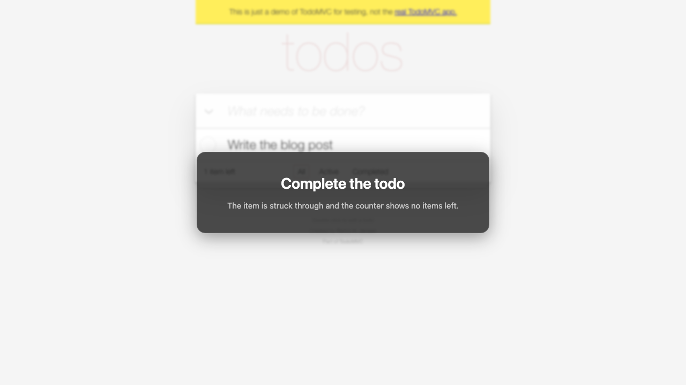
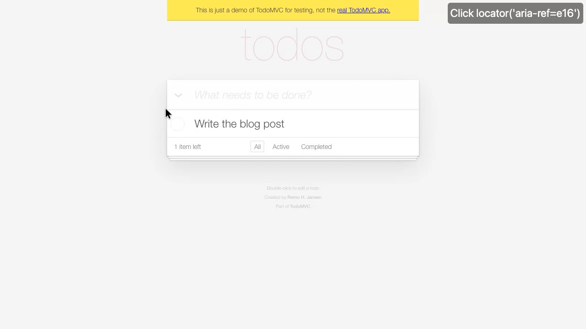
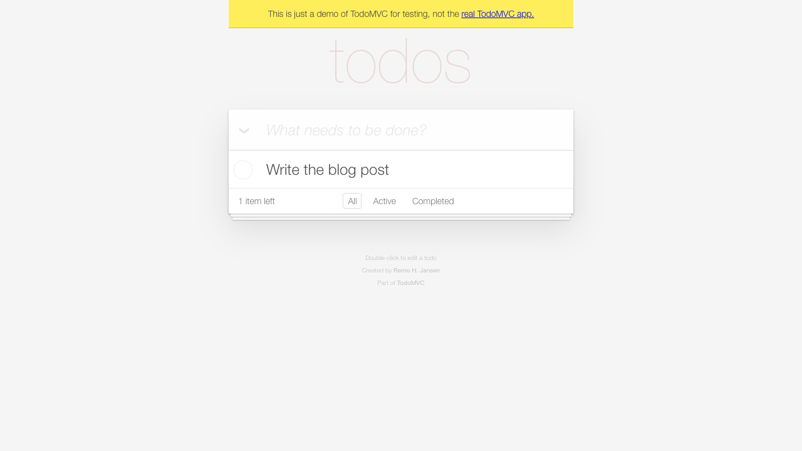
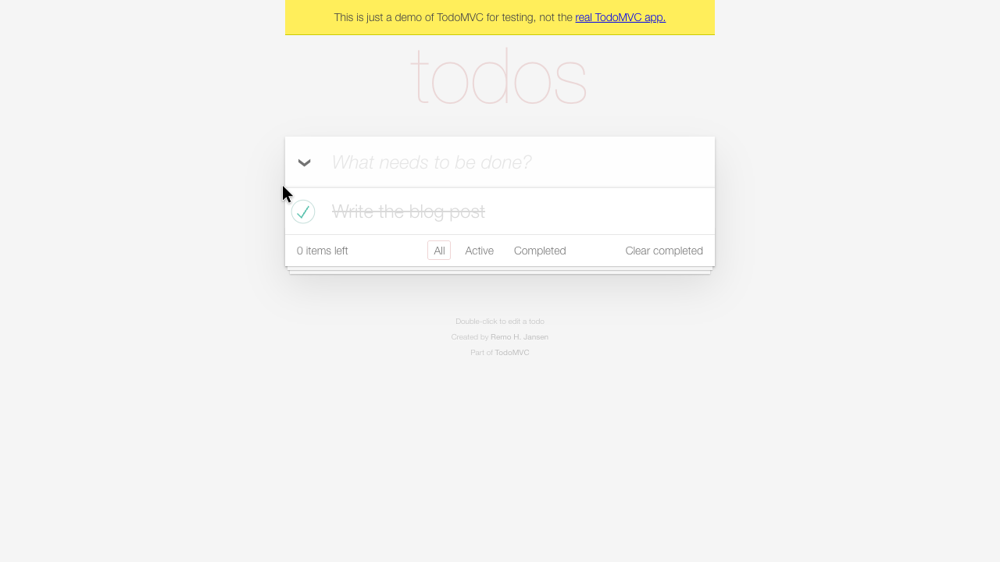

Agents write code faster than we can review it. In our project, most pull requests are now opened by an agent. The diff helps us review the implementation. To check the behavior, someone still had to pull the branch locally, start the application, and click through the flow. Even with a preview environment, the reviewer still has to click through the flow manually to see the result.

We moved that step to the agent. When a change affects the UI, the agent starts the application, records the flow, and captures screenshots of key states. It inspects these captures before presenting them to the developer and attaching them to the pull request.

In this blog post, I share why we're doing this, how the [Playwright CLI](https://github.com/microsoft/playwright-cli) makes it possible, and what it looks like in practice.

## Why

Our pull request template has a "Proof it works" section, where the author shows how they verified the change with screenshots and recordings. This gives reviewers something concrete to check and encourages authors to review their own work first.

For UI changes, a screenshot says more than a paragraph claiming that the change works, and it's also more fun. The reviewer can see the result at a glance, without having to imagine it from a description or run the application.

That lets the reviewer focus on the change: does it do what was asked, does it look right, and what needs a closer look?

At first, we only asked for screenshots. We later added recordings to show what happens between states: what was clicked, what appeared, and in what order. Recordings expose bugs that a screenshot can miss, like jumping focus, a flash of empty content, or a dialog that doesn't show. They also give reviewers more context and make entire flows easier to share.

The captures also help the agent catch its own mistakes. They can reveal issues that tests miss, even when all tests are green. We now require the agent to inspect every screenshot before presenting it, so it can fix these issues before review.

This is the same division of work that I described in [Keep Agentic AI Simple](../keep-agentic-ai-simple-a-practical-workflow-for-software-development/index.md): the agent implements, and the team verifies. The captures make the verification cheaper for the team, and keep the agent honest. As a bonus, the recordings also give us something concrete to show to stakeholders, which ties in with [Sprint Zero is about building momentum](../sprint-0-is-about-building-momentum/index.md).

## Playwright CLI

I'm a big fan of Playwright. The [Playwright CLI](https://github.com/microsoft/playwright-cli) makes this workflow practical: it's built for coding agents, drives its own browser, and returns compact text that helps the agent understand what happened after each action.

The CLI can also attach to a browser that's already running, such as your own Chrome or Edge, through the Playwright extension or Chrome DevTools Protocol (CDP). It can read console messages, inspect network requests, and work with cookies and local and session storage. That makes it useful for debugging a failing flow or mocking an API response with the `route` command too.

In [Vibe testing with Playwright](../vibe-testing-with-playwright/index.md), I explored the Playwright MCP server. These days, I prefer the CLI. As I mentioned in [Keep Agentic AI Simple](../keep-agentic-ai-simple-a-practical-workflow-for-software-development/index.md), MCP servers bloat the agent's context window, while a CLI tool with a skill only loads what's needed. The agent already knows its way around CLI tools, which also makes the workflow faster.

### Installation

We install the CLI as a development dependency, so every developer and every agent uses the same version:

```bash
pnpm add -D @playwright/cli
```

The package also ships with an Agent Skill that teaches the agent how to use its commands. Install it in the repository with:

```bash
pnpm exec playwright-cli install --skills
```

This command installs the skill instructions and reference guides locally in your repository, so supported agents can discover and load them.

## Example

Let's try this with the [TodoMVC demo](https://demo.playwright.dev/todomvc). We'll record a short flow using the same steps our agent follows: start recording before the first step, add a callout for each action, introduce each step with a chapter card, and take a screenshot at the end of each step.

The video commands below use the [Screencast API](https://playwright.dev/docs/api/class-screencast) to record the agent's browser interactions.

```bash
pnpm exec playwright-cli open https://demo.playwright.dev/todomvc
pnpm exec playwright-cli video-start e2e/test-results/review/add-todo/add-todo.webm --size=1280x720
pnpm exec playwright-cli video-show-actions

pnpm exec playwright-cli video-chapter "Add a todo" --description="The new item appears in the list and the counter shows one item left."
pnpm exec playwright-cli snapshot
pnpm exec playwright-cli fill e8 "Write the blog post" --submit
pnpm exec playwright-cli screenshot --filename=e2e/test-results/review/add-todo/todo-added.png

pnpm exec playwright-cli video-chapter "Complete the todo" --description="The item is struck through and the counter shows no items left."
pnpm exec playwright-cli click e16
pnpm exec playwright-cli screenshot --filename=e2e/test-results/review/add-todo/todo-completed.png

pnpm exec playwright-cli video-stop
pnpm exec playwright-cli close
```

The accessibility snapshot gives the agent refs to interact with page elements. It lists buttons, textboxes, and checkboxes as structured text, with their names and states.

In this flow, the initial snapshot identifies the textbox as `e8`, which the agent uses in the `fill` command above:

```yaml
- generic [ref=e6]:
    - heading "todos" [level=1] [ref=e7]
    - textbox "What needs to be done?" [active] [ref=e8]
- contentinfo [ref=e9]:
    - paragraph [ref=e10]: Double-click to edit a todo
```

After adding the todo, the agent reads the updated snapshot to find the checkbox, which is `e16` in this session.

The snapshots guide the agent through these interactions, and the recording lets the reviewer follow along. Each chapter opens with a card over a blurred page to explain what's about to happen and what to look for.



During each chapter, annotations show what the agent is doing. A callout names the action, the target is highlighted, and an animated pointer moves to it.



At the end of each chapter, the agent takes a screenshot of the result. These screenshots give the reviewer a closer look at each state and let the agent check how the page looks before attaching them to the pull request.





### Keep recordings short

The browser stays open between commands. Each CLI command starts a separate process that connects to it, adding a pause to the recording after every action. For longer flows, use `run-code --filename=<script>.js` with `page.screencast` to control the pacing. The CLI's skill recommends this approach for recordings used as proof of work. The same flow takes about 10 seconds in a single script, including action callouts, compared to 23 seconds with separate commands:


If you want to run this example manually, save the function below as `record-todo.js`.

<details>
<summary>The recording script</summary>

```js:record-todo.js
async (page) => {
	const output = 'e2e/test-results/review/add-todo';
	await page.setViewportSize({ width: 1280, height: 720 });
	await page.evaluate(() => localStorage.clear());
	await page.reload();
	const input = page.getByRole('textbox', { name: 'What needs to be done?' });
	await input.waitFor();

	await page.screencast.start({
		path: `${output}/add-todo.webm`,
		size: { width: 1280, height: 720 },
	});

	try {
		await page.screencast.showActions();
		await page.screencast.showChapter('Add a todo', {
			description: 'The new item appears in the list and the counter shows one item left.',
			duration: 1500,
		});
		await input.fill('Write the blog post');
		await input.press('Enter');
		await page.getByText('1 item left', { exact: true }).waitFor();
		await page.waitForTimeout(1000);
		await page.screenshot({ path: `${output}/todo-added.png` });

		await page.screencast.showChapter('Complete the todo', {
			description: 'The item is struck through and the counter shows no items left.',
			duration: 1500,
		});
		const todo = page.locator('.todo-list li').filter({ hasText: 'Write the blog post' });
		await todo.getByRole('checkbox').check();
		await page.getByText('0 items left', { exact: true }).waitFor();
		await page.waitForTimeout(1000);
		await page.screenshot({ path: `${output}/todo-completed.png` });
	} finally {
		await page.screencast.hideActions();
		await page.screencast.stop();
	}
}
```

Then run these commands from the project root:

```bash
pnpm exec playwright-cli open https://demo.playwright.dev/todomvc
pnpm exec playwright-cli run-code --filename=record-todo.js
pnpm exec playwright-cli close
```

</details>

### Into the pull request

When opening the pull request, the agent uses the [GitHub CLI](https://cli.github.com/) to upload the screenshots and recording, without committing them to the repository. It also writes the description, so we don't have to prepare it or upload the captures manually.

First, the agent writes the pull request description to a temporary Markdown file, `/tmp/pr-body.md`. It includes the screenshots using their local file paths, with alt text that explains what to look for:

```md
## Proof it works


```

Next, the agent opens the pull request. The `--body-file` option reads the description from that Markdown file, and each `--attach` option uploads one of the captures:

```bash
gh pr create --title "Add and complete a todo" --body-file /tmp/pr-body.md \
  --attach e2e/test-results/review/add-todo/todo-added.png \
  --attach e2e/test-results/review/add-todo/todo-completed.png \
  --attach e2e/test-results/review/add-todo/add-todo.webm
```

For the two screenshots, the CLI replaces the local paths in the description with the uploaded URLs, keeping the alt text. The recording isn't mentioned in the Markdown file, so the CLI adds it at the end of the description, where GitHub displays it as a video player.

:::note
For more details, see [Attaching files with GitHub CLI](https://docs.github.com/en/github-cli/github-cli/attaching-files-with-github-cli). PNG, JPEG, GIF, SVG, MP4, MOV, and WebM files are supported. To add files to an existing pull request, use `gh pr edit <number> --attach <file>`.
:::

## Making it the default

We added the workflow to `AGENTS.md` and the evidence requirements to the pull request template to make captures part of every UI change. If the agent can't create them, it has to say so.

These are our project-specific instructions in `AGENTS.md` (slightly shortened):

```md:AGENTS.md
### Validation evidence

After completing UI work, create screenshots of the relevant screens and a recording of the relevant flow, and present both to the user as a validation step. When the work is opened as a pull request, attach both to it. Screenshots show each state worth judging; the recording shows the steps between them. Both are also a self-check: look at every screenshot before presenting it.

- Start the app in end-to-end mode, so the stand-in identity provider signs the browser in without interaction
- Save every capture under `e2e/test-results/review/<feature-slug>/`, which is gitignored
- Open the app: `pnpm exec playwright-cli open https://localhost:7472`
- Record a flow: `video-start <path>.webm --size=1280x720` before the first step, `video-show-actions` so every action gets a callout, `video-chapter "<step>" --description="<what to look for>"` before each step, and `video-stop` after the last
- Take a screenshot at the end of each chapter: `screenshot --filename=<path>.png`
- Drive a longer flow from one `run-code` script with short pauses: a chapter card of 1500 ms and a hold of about a second after each state change. Remove unnecessary waiting from the recording.
```

And this is the relevant part of the pull request template, which is the same for humans and agents:

```md:.github/pull_request_template.md
## Proof it works

<!-- A description is a claim; this section is the evidence. Reviewers should not
     have to take your word for it. New behavior comes with a test that fails without this change. -->

**Tests.** Run the layer(s) that own the risk and paste each command with the closing summary of its output.

**Screenshots and a recording, for UI changes.** Show the changed screen in the running app:
a screenshot of each state worth judging and a recording of the steps between them.

- Reference each screenshot by its relative path, with alt text that says what the reviewer should see:
  ``
- Pass every referenced screenshot and the `.webm` recording to `gh` as `--attach` arguments
```

## Lessons from our project

A few things we ran into while setting this up:

- **Signing in.** Our normal sign-in flow uses Entra ID with multi-factor authentication, so the agent can't sign in on its own. We use an environment variable to start the application in end-to-end mode, just like our Playwright tests. This swaps the identity provider for an in-repo stand-in that signs the browser in as a test user. Everything else stays real, including the API and a throwaway database.
- **Checking the video.** The agent extracts a few frames with ffmpeg to inspect the recording with its image tools. When ffmpeg isn't available, it can open a small HTML page with a `<video>` element, seek to a few points in time, and take screenshots. This lets it check the chapter cards, callouts, and final states.
- **Pacing.** Chapter cards, timed overlays, and action callouts already wait for their duration. Our first recordings added extra pauses after them, so most of the video was spent waiting. Only add a pause when the viewer needs time to inspect a completed state.
- **Preserving captures.** Running the end-to-end test suite empties the test results folder, including the captures. Create the captures after the test run, or copy the files to another location first.
- **Content Security Policy.** The chapter cards and callouts are injected into the page using inline styles, which are blocked by our nonce-based CSP. That's why the review browser is opened with the config file below. Its `contextOptions` accept any browser context option. We set `bypassCSP`, together with `ignoreHTTPSErrors` for the development certificate, and a viewport of 1280 by 720.

```json:.playwright/cli.config.json
{
	"browser": {
		"contextOptions": {
			"bypassCSP": true,
			"ignoreHTTPSErrors": true,
			"viewport": { "width": 1280, "height": 720 }
		}
	}
}
```

## Benefits

**Less setup for reviewers.** I can review a UI change from the pull request, on any device. The alt text tells me what to look for, the screenshots show the states, and the recording shows the flow. For small changes, I might not even look at the code.

**Earlier feedback for the agent.** By checking the captures, the agent can catch visual mistakes before asking for review, even when the tests pass. It's the same feedback loop as the logs and traces in [Improve your AI coding agent with runtime context from Aspire MCP](../improve-your-ai-coding-agent-with-runtime-context-from-aspire-mcp/index.md), but applied to the UI.

**Reusable evidence.** Recordings can be shared with stakeholders. We can also reuse the same captures in release notes and demos.

The best part is that this workflow doesn't need extra infrastructure. The CLI sits next to our Playwright tests, and the attachments live on GitHub. The shared instructions set the same expectations for humans and agents, including reporting a missing capture.

:::tip
For a broader approach to reviewing agent-written code, I recommend reading [How the Claude Code team does code review](https://claude.dev/blog/solving-code-review-at-anthropic/). Their risk-based review resonates with how our team works and, in combination with the visual captures, helps us focus our attention where it matters most. Give it a read!
:::

## Tips from readers

After sharing this post, I received a few useful tips:

- **Record before and after.** Record the same flow before and after the change, so reviewers can compare the behavior directly.
- **Add screenshot diffs.** Compare the before and after screenshots and include a diff image that highlights the changed pixels. This makes small visual changes easier to spot. Use the same viewport and test data for both captures to keep the comparison useful.
- **Try agent-browser.** Readers also suggested [agent-browser](https://github.com/vercel-labs/agent-browser) from Vercel Labs as an alternative for reducing token consumption. Its [snapshot filters](https://github.com/vercel-labs/agent-browser#snapshot-options) can limit the output to interactive elements, remove empty structural elements, or focus on a specific part of the page, so the agent has less context to read.

## Conclusion

Screenshots show the outcome, recordings show the flow, and inspecting both helps the agent catch mistakes before review. For small changes with little risk, this evidence may be enough to review the change without looking at the code. When the code needs a closer look, the captures give the reviewer context by showing how the change behaves in the running application.

If you want to try this out yourself, install the Playwright CLI, make sure the agent can sign in, and add the workflow to your `AGENTS.md` file and pull request template.

For me, this means less time setting up and clicking through the application, and more time delivering value.
